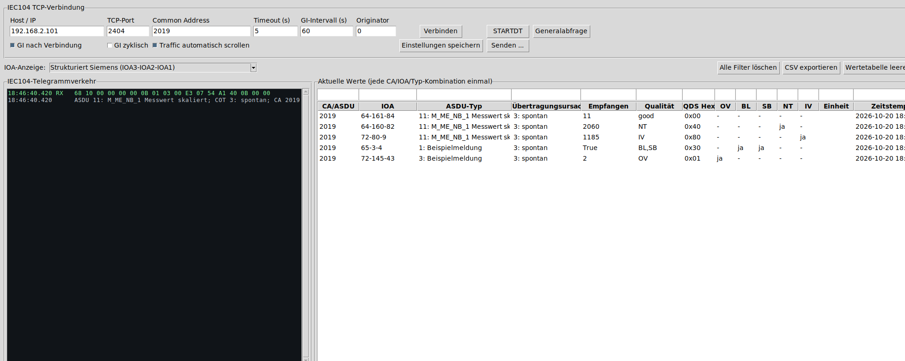

# IEC104 Reader für Windows

Portable grafische Anwendung zum Lesen, Analysieren und kontrollierten Senden von IEC 60870-5-104 über TCP/IP.
Version 1.5.1: TXT-Empfangslog für alle Tabellenwerte einschließlich Generalabfragen und unveränderter Wiederholungen.
https://github.com/TheBam1990/IEC104-Reader/releases/tag/v1.5.1

## Oberfläche



## Funktionen

- einzelne portable `IEC104-Reader.exe` ohne Installation
- Ziel-IP/Hostname, TCP-Port und Common Address einstellbar
- STARTDT und Generalabfrage
- optionale Generalabfrage direkt nach dem Verbinden
- optional zyklische Generalabfrage mit einstellbarem Intervall
- Sequenznummern und IEC104-S-Bestätigungen
- automatische Antwort auf TESTFR
- vollständige RX-/TX-Anzeige in Hexadezimaldarstellung
- Sitzungslog `IEC104-Telegrammverkehr.txt` neben der EXE; wird bei jedem Start neu begonnen
- Wertetabelle mit getrennten Spalten für CA/ASDU und IOA sowie ASDU-Typ, Übertragungsursache, Empfangswert, Qualität und Zeitstempel
- Pro CA/IOA genau eine Zeile: neue Telegramme aktualisieren Wert, Typ, Übertragungsursache, Qualität und Zeitstempel, auch bei wechselnder Übertragungsursache oder wechselndem ASDU-Typ.
- umschaltbare IOA-Darstellung: unstrukturiert dezimal, WinPP/Telegramm
  (IOA1-IOA2-IOA3, Low Byte zuerst) oder Siemens (IOA3-IOA2-IOA1,
  Darstellung A-B-C)
- Qualitätskennzeichen einzeln sichtbar und filterbar: OV, BL, SB, NT und IV sowie rohes QDS-Byte
- eigenes Live-Filterfeld über jeder Tabellenspalte; mehrere Filter wirken gemeinsam
- CSV-Export der aktuell sichtbaren Tabellenzeilen
- platzsparende Sendezentrale in einem eigenen Dialogfenster
- Einzel-, Doppel-, Stufen- und Bitmusterbefehle
- normierte, skalierte und Gleitkomma-Sollwerte
- getrennte Aktionen für Select/Auswahl und Execute/Ausführung
- optionale CP56-Zeitstempel bei Befehlen
- General- und Zählerabfrage, Einzelwert lesen, Zeitsynchronisation, Test,
  Prozessreset und Verzögerungsermittlung
- Parameterwerte und Parameteraktivierung
- frei konfigurierbare ASDUs und Vorlagen für die IEC104-Dateitypen 120–126
- ASDU-Vorschau in Hexadezimaldarstellung
- Sicherheitsrückfrage vor jedem einzelnen Befehl
- IOA beim Senden wahlweise dezimal oder passend zum gewählten Siemens-/WinPP-Modus strukturiert eingebbar
- lokale Speicherung der Verbindungseinstellungen und Faktoren

## Bedienung

1. IP-Adresse oder Hostnamen des IEC104-Servers eintragen.
2. TCP-Port eintragen, normalerweise `2404`.
3. Common Address der Gegenstelle eintragen.
4. **Verbinden** drücken. Das Programm sendet STARTDT automatisch.
5. Bei aktivierter Option **GI nach Verbindung** folgt automatisch eine Generalabfrage.
6. Empfangene Werte erscheinen rechts in der Tabelle.

Die Filterfelder befinden sich direkt über den jeweiligen Spalten. Mehrere ausgefüllte Filter werden als UND-Verknüpfung ausgewertet. Mit **Alle Filter löschen** oder Escape werden alle Zeilen wieder eingeblendet.

### Tabellenempfang als TXT mitloggen

Die Checkbox **Tabelle als TXT mitloggen** befindet sich in derselben Zeile wie **IOA-Anzeige**. Beim Einschalten wählt man die TXT-Datei aus. Danach wird jeder empfangene und dekodierte Tabellenwert protokolliert: die vollständigen Daten einer Generalabfrage (GA), spontane und zyklische Telegramme sowie identische Wiederholungen. Bereits vor dem Einschalten vorhandene Tabellenwerte werden nicht nachträglich geschrieben.

Das UTF-8-TXT enthält tabulatorgetrennte Spalten mit Logzeit, Ereignis (NEU/EMPFANGEN) und allen Spalten der Wertetabelle einschließlich CA, IOA, Qualitätsflags und Zeitstempel. Auch durch Tabellenfilter ausgeblendete Empfangswerte werden geloggt. Reine Anzeigeänderungen, etwa das Umschalten der IOA-Darstellung oder der Filter, erzeugen keine Einträge. Bestehende Dateien werden ergänzt. Zum Beenden die Checkbox abwählen; beim Schließen des Programms wird die Datei ebenfalls geschlossen. Bei Schreibfehlern wird das Tabellenlog mit Fehlermeldung gestoppt.

### Strukturierte IOA-Darstellung

IEC 60870-5-104 überträgt die drei IOA-Oktette mit dem niederwertigsten Byte
zuerst. WinPP/Telegramm zeigt sie deshalb als `IOA1-IOA2-IOA3`. Siemens
bezeichnet die strukturierte Adresse dagegen als `A-B-C` und berechnet den
Dezimalwert mit `A × 65536 + B × 256 + C`; dies entspricht
`IOA3-IOA2-IOA1`. Beispiel für IOA `4235604` (`0x40A154`): WinPP/Telegramm
`84-161-64`, Siemens `64-161-84`.

## Telegramme senden

Die Schaltfläche **Senden ...** öffnet die Sendezentrale, ohne das
Hauptfenster zu vergrößern. Sie enthält getrennte Reiter für:

- **Standard:** Generalabfrage, Zählerabfrage, IOA lesen, Zeitsynchronisation,
  Testbefehl, Prozessreset und Verzögerungsermittlung
- **Schalten:** Einzel-, Doppel-, Stufen- und Bitmusterbefehle, wahlweise mit
  CP56-Zeitstempel sowie getrennt als Auswahl oder Ausführung
- **Sollwerte:** normierte, skalierte und Gleitkommawerte, ebenfalls mit
  Select-before-operate und optionalem CP56-Zeitstempel
- **Parameter:** Typen 110–113 einschließlich Qualifier
- **ASDU / Datei:** frei bearbeitbarer Typ, VSQ, COT, IOA und Hex-Payload sowie
  Vorlagen für die standardisierten Datei-ASDUs 120–126

Common Address und Originator werden oben im Hauptfenster einmal eingestellt
und von allen Reitern verwendet. Vor dem Senden wird die erzeugte ASDU als
Hexfolge angezeigt. Schreibende und potenziell gefährliche Aktionen verlangen
eine ausdrückliche Bestätigung.

Die Dateivorlagen stellen bewusst keinen automatischen Dateitransfer dar. Ein
vollständiger Transfer ist zustandsbehaftet und muss hinsichtlich Dateiname,
Abschnitten, Segmenten und Bestätigungen exakt zur Gegenstelle passen. Die
Vorlagen erlauben das kontrollierte Erzeugen solcher ASDUs anhand der jeweiligen
Gerätedokumentation.

## Unterstützte Überwachungs-ASDUs

Unter anderem Einzel- und Doppelmeldungen, Stufenstellungen, Bitmuster, normierte, skalierte und Gleitkomma-Messwerte sowie Zählwerte – jeweils ohne Zeitstempel sowie mit CP24- oder CP56-Zeitstempel, soweit durch die standardisierten Typen 1–21 und 30–37 definiert.

Unbekannte ASDUs bleiben vollständig im Telegrammfenster sichtbar, auch wenn dafür keine Tabellenzeile erzeugt wird.

## Sicherheit

- Jeder Befehl muss über eine Sicherheitsrückfrage ausdrücklich bestätigt werden.
- Auswahl und Ausführung sind getrennte Schaltflächen; ein Select wird nicht automatisch ausgeführt.
- Einzelbefehl: `0` oder `1`. Doppelbefehl: `1` für AUS und `2` für EIN.
- Die Bedienperson muss CA, IOA, Befehlstyp und Wert anhand der Anlagendokumentation prüfen.
- Es verwendet keine Cloud-Dienste und keine Telemetrie.
- Einstellungen und Faktoren werden ausschließlich lokal gespeichert.

## EXE selbst bauen

Unter Windows `build-windows.bat` starten. Das Ergebnis liegt anschließend unter:

```text
dist\IEC104-Reader.exe
```

## Lizenz

MIT
